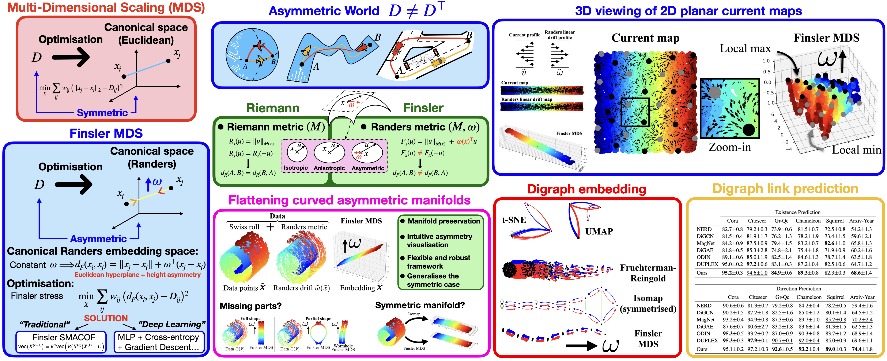

# Finsler Multi-Dimensional Scaling: Manifold Learning for Asymmetric Dimensionality Reduction and Embedding [\[Paper CVPR 2025\]](https://arxiv.org/abs/2503.18010)

---

## Abstract

Dimensionality reduction is a fundamental task that aims to simplify complex data by reducing its feature dimensionality while preserving essential patterns, with core applications in data analysis and visualisation. To preserve the underlying data structure, multi-dimensional scaling (MDS) methods focus on preserving pairwise dissimilarities, such as distances. They optimise the embedding to have pairwise distances as close as possible to the data dissimilarities. However, the current standard is limited to embedding data in Riemannian manifolds. Motivated by the lack of asymmetry in the Riemannian metric of the embedding space, this paper extends the MDS problem to a natural asymmetric generalisation of Riemannian manifolds called Finsler manifolds. Inspired by Euclidean space, we define a canonical Finsler space for embedding asymmetric data. Due to its simplicity with respect to geodesics, data representation in this space is both intuitive and simple to analyse. We demonstrate that our generalisation benefits from the same theoretical convergence guarantees. We reveal the effectiveness of our Finsler embedding across various types of non-symmetric data, highlighting its value in applications such as data visualisation, dimensionality reduction, directed graph embedding, and link prediction.

---

## Installation

This project does not require any special dependencies or installations. Dependencies can be installed with the usual package installers, e.g. `pip` or `conda`: `pip install [package-name]`.


1. Mandatory basic packages: `numpy`, `scikit-learn`, `scipy`, `joblib`

2. Optional packages for some experiments: `umap`, `networkx`

---

## Quick usage

To compute the Finsler Multi-Dimensional Scaling embedding on a (asymetric) square dissimilarity matrix `D` using the **corrected** Finsler SMACOF algorithm, simply compute

```python
import _mds_finsler

embedding, _ = _mds_finsler.smacof(
    D, 
    randers_w_alpha=alpha, 
    metric=True,
    n_components=proj_dim,
    random_state=0,
)
```

Here `alpha` is the magnitude of the canonical Randers drift vector $\omega=(0,\ldots,0,\alpha)^\top$ in the `proj_dim`-dimensional embedding, with $0\leq\alpha<1$. Other options include user-supplied initial positions, stopping criteria, parallel random restarts, and symmetric nonuniform weights (`weight=W`). The legacy `check_monotony=False` switch requests a fixed `max_iter` iterations rather than early stopping.

**The correct implementation is [`_mds_finsler.py`](_mds_finsler.py).** The previous implementation is retained as [`_mds_finsler_legacy.py`](_mds_finsler_legacy.py) for historical reproducibility, **not** for new results. Old `pseudo_inv_solver` and `project_on_V` arguments are accepted by the new API only for compatibility and have no effect.

## Correction to the Finsler MDS update rule

**Important correction (2026).** We identified small errors in the derivation of the original [CVPR 2025 Finsler MDS paper](https://arxiv.org/abs/2503.18010), especially equations (7) and (9), affecting its Proposition 2 and the original implementation (`_mds_finsler_legacy.py`). The corrected derivation appears in Appendix C of **[Harnessing Data Asymmetry in Manifold Learning](#citation)** (Thomas Dagès, Simon Weber, Daniel Cremers, Ron Kimmel; accepted at NeurIPS 2026). Please use the updated `_mds_finsler.py` for new experiments and cite the NeurIPS 2026 paper alongside the original CVPR 2025 paper.

Given $N$ observations with directed dissimilarities $D_{ij}\geq 0$ (where $D_{ii}=0$), symmetric pair weights $w_{ij}=w_{ji}\geq 0$ (where $w_{ii}=0$), and an embedding $Y\in\mathbb{R}^{N\times m}$, the stress is

$$
\sigma_F^2(Y)=\sum_{i,j=1}^{N}w_{ij}\bigl(\|y_j-y_i\|_2+\omega^\top(y_j-y_i)-D_{ij}\bigr)^2.
$$

Define $D_S=(D+D^\top)/2$, the weighted graph Laplacian $V$ and the configuration-dependent matrix $B(Y)$ as

$$
V_{ij}=\begin{cases}
-w_{ij}, & i\ne j,\\
\sum_{k\ne i}w_{ik}, & i=j,
\end{cases}
\qquad
B_{ij}(Y)=\begin{cases}
-\dfrac{w_{ij}(D_S)_{ij}}{\|y_j-y_i\|_2}, & i\ne j,\ \|y_j-y_i\|_2>0,\\
0, & i\ne j,\ \|y_j-y_i\|_2=0,\\
-\sum_{k\ne i} B_{ik}(Y), & i=j.
\end{cases}
$$

With $\mathbf 1_N$ the all-ones vector and $\odot$ the Hadamard product, let

$$
C=\bigl[W\odot(D-D^\top)\bigr]\mathbf 1_N\omega^\top.
$$

The **corrected Finsler SMACOF update** is

$$
\boxed{
Y^{(k+1)}=
V^\dagger\left[B(Y^{(k)})Y^{(k)}-\tfrac12 C\right]
\left(I_m-\frac{\omega\omega^\top}{1+\|\omega\|_2^2}\right).
}
$$

In the usual **uniform-weight case**, $w_{ij}=1$ for all $i\ne j$, the right-hand side is centered and $V=N I_N-\mathbf 1_N\mathbf 1_N^\top$, giving the even cheaper update

$$
\boxed{
Y^{(k+1)}=
\frac1N\left[B(Y^{(k)})Y^{(k)}-\tfrac12 C\right]
\left(I_m-\frac{\omega\omega^\top}{1+\|\omega\|_2^2}\right).
}
$$

Thus no pseudoinverse is needed for uniform weights, exactly as in scikit-learn's original uniform-weight SMACOF implementation, which uses `X = (B @ X) / N`. For **nonuniform symmetric weights**, `_mds_finsler.py` forms the $N\times N$ weighted graph Laplacian $V$ and computes `np.linalg.pinv(V, hermitian=True)` **once**, reusing that pseudoinverse at each iteration and across random restarts. For disconnected weight graphs, the pseudoinverse selects the componentwise-centered solution. Neither path requires Cholesky, Kronecker products, vectorization into a large linear system, GMRES, or CG. The corrected majorization-minimization iteration yields a nonincreasing raw Finsler stress in exact arithmetic. The code reports the **directed** stress summed over both `(i,j)` and `(j,i)`; in the symmetric zero-drift limit this is twice scikit-learn's convention of summing undirected pairs. This factor does not change the embedding.

The new implementation is more stable and cheaper than the original buggy one.

---

## Demos

Run the following scripts to replicate the visual results from the paper (the embeddings slightly change when using the corrected solver):

- `main_swiss_roll_full`: Figs 2, 6, 7

- `main_swiss_roll_hole`: Fig 3

- `main_2D_maps`: Fig 8 (river), Fig 4 (sea)

- `main_graph`: Fig 5

---

## Note on (worm)holes

The Finsler wormhole code is built on top of the code for the original symmetric wormhole criterion, from the paper *Bracha et al. Wormhole Loss for Partial Shape Matching, NeurIPS 2024* [[paper]](https://proceedings.neurips.cc/paper_files/paper/2024/hash/ed24eafde44aef581b9f605319583b6d-Abstract-Conference.html)[[code]](https://github.com/ABracha/Wormhole/tree/main). Our code is also an official implementation for this work by taking `alpha = 0` for the embedding's canonical Randers space.

If you are using the vanilla or Finsler wormhole embedding method, or using our implementation for the weighted SMACOF algorithm (which is not implemented in scikit-learn), please also cite the original wormhole paper.

```bibtex
@article{bracha2025wormhole,
  title={Wormhole Loss for Partial Shape Matching},
  author={Bracha, Amit and Dag{\`e}s, Thomas and Kimmel, Ron},
  journal={Advances in Neural Information Processing Systems},
  volume={37},
  pages={131247--131277},
  year={2025}
}
```


## Acknowledgement

Our implementation of the Finsler SMACOF algorithm is an adaptation of the SMACOF algorithm implementation in scikit-learn [[sklearn:_mds.py]](https://github.com/scikit-learn/scikit-learn/blob/da08f3d99/sklearn/manifold/_mds.py#L193).


---
## License

This project is licensed under the BSDS-3 License. See the `LICENSE` file for details.

---

## Citation

If you find our work useful in your research, or if you use **Finsler MDS or the corrected implementation**, please cite the original CVPR 2025 paper **and** the follow-up NeurIPS 2026 paper correcting it:

```bibtex
@inproceedings{dages2025finsler,
  title={Finsler Multi-Dimensional Scaling: Manifold Learning for Asymmetric Dimensionality Reduction and Embedding},
  author={Dag{\`e}s, Thomas and Weber, Simon and Lin, Ya-Wei Eileen and Talmon, Ronen and Cremers, Daniel and Lindenbaum, Michael and Bruckstein, Alfred M and Kimmel, Ron},
  booktitle={Proceedings of the Computer Vision and Pattern Recognition Conference},
  pages={25842--25853},
  year={2025}
}

@inproceedings{dages2026harnessing,
  title={Harnessing Data Asymmetry in Manifold Learning},
  author={Dag{\`e}s, Thomas and Weber, Simon and Cremers, Daniel and Kimmel, Ron},
  booktitle={Advances in Neural Information Processing Systems},
  year={2026},
  note={Accepted at NeurIPS 2026}
}
```